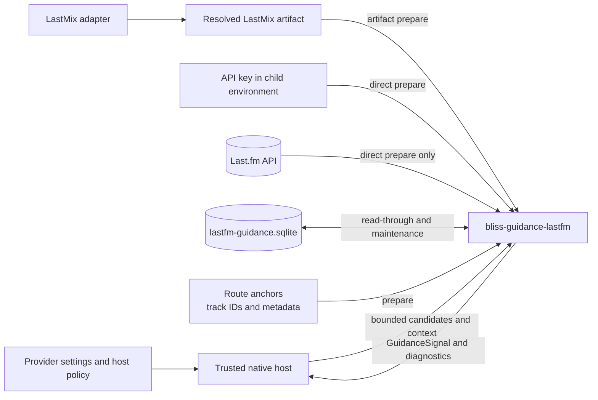

# bliss-guidance-lastfm

`bliss-guidance-lastfm` is a provider addon for a Bliss-first host using the
[`bliss-playlist-guidance-spi`](https://github.com/chrober/bliss-playlist-guidance-spi).
Current hosts use two acquisition modes. **Artifact mode** consumes a frozen,
resolved `semantic-evidence-v1` artifact prepared by trusted host code (for
example through LastMix). **Direct mode** obtains relations once during
`prepare`, using an API key inherited only through the process environment,
then persists them in a versioned provider-owned SQLite graph and freezes the
relations needed by that job. Both modes return the same
bounded `lastfm_track` and `lastfm_artist` guidance; `score` never performs
network I/O.

The host-neutral wire contract is maintained by
[bliss-playlist-guidance-spi](https://github.com/chrober/bliss-playlist-guidance-spi).

Its SPI provider ID is `lastfm-guidance`. In artifact mode, trusted Lyrion host
code and LastMix obtain and resolve evidence. In direct mode, this binary
contacts Last.fm only during `prepare`.

## Data and information flow



The separately installed Lyrion provider owns the LastMix/API Key choice and
its default channel settings. A compatible host owns opt-in and optional
host/job overrides. In LastMix mode, trusted host integration resolves track-
and artist-similarity observations against the frozen local inventory and
writes only resolved candidate identities into `semantic-evidence-v1`.

This add-on consumes no Lyrion-plugin preference directly. In artifact mode, a
trusted host passes a prepared artifact in an SPI v2 `prepare` descriptor with
its expected SHA-256; the provider verifies the hash before decoding it. In
direct mode, the trusted host passes non-secret connection limits and supplies
the API key through the child process environment only.

During artifact-mode `prepare`, the add-on reads the artifact once and builds
an index of `source entity -> local candidate ID -> channel -> strongest
support`. During direct-mode `prepare`, it resolves the requested anchor
relations from the SQLite graph or bounded HTTP requests, transactionally
persists complete responses, and builds the same in-memory shape. It also
uses the supplied local anchors to build `track anchor ID -> Last.fm artist
source ID(s)`: it joins an anchor's artist MBID to an artist edge's MBID first,
then uses a normalized artist-name fallback only when no MBID relation exists.
The result is frozen for that provider session and reported as
`track_artist_mappings` in prepared diagnostics.

For each `score` request the add-on expands all applicable local context track
IDs into those prepared artist source IDs. This includes global
`context_track_ids` and both `left_anchor_id` and `right_anchor_id` for an edge;
raw track IDs remain present so recording-level evidence still works. It then
evaluates only the requested candidate batch and emits positive signals for the
independently weighted `lastfm_track` and `lastfm_artist` channels. Within one
channel it retains the strongest relation after combining raw Last.fm score (or
rank) with identity confidence. Unresolved entities, unavailable endpoint
evidence, and candidates without support emit no signal; they remain neutral.

## Track, artist, and Last.fm identities

The four relevant identities are intentionally different:

| Identity | Example shape | Owner and purpose |
| --- | --- | --- |
| Host route track ID | `lms-track-123` | The optimizer's score context and Better Call Bliss source/history anchors. |
| Last.fm artist source ID | `artist:normalized-artist-name` | The resolved `artist.getSimilar` evidence edge. It is not sent back as a route track ID. |
| MusicBrainz artist ID | `xxxxxxxx-xxxx-xxxx-xxxx-xxxxxxxxxxxx` | Stable cross-source join key carried in the anchor and resolved artifact whenever available. |
| Local candidate ID | `bliss-row-456` | A frozen, eligible local Bliss/LMS candidate. This is the only ID the provider may return in a signal. |

In other words, an artist relation follows the chain `lms-track-123 -> anchor
artist MBID -> artist:... -> bliss-row-456`. Recording similarity can use the
host track ID directly where the artifact has that relationship. This prevents a
Last.fm artist source ID from being mistaken for either a route member or a
local candidate.

The optimizer owns channel weights and applies these advisory signals only after
Bliss has admitted candidates acoustically and all hard constraints have passed.

`lastfm_track` declares support for the host's `bounded_influence` policy.
`lastfm_artist` declares both `bounded_influence` and `target_share` support.
Those declarations do not alter the raw observations emitted by this provider:
the host chooses and applies the policy after it receives the same normalized
track or artist support. In particular, the provider never calculates a target
share multiplier or ranks candidates itself.

Direct mode accepts only trusted launch configuration: `acquisition_mode`,
provider-owned store and legacy-migration paths, retrieval policy, persistence
scope, result limit, deadline, bounded request concurrency, and (where a test
or trusted host needs it) the Last.fm endpoint. Its API key is read solely from
`BLISS_GUIDANCE_LASTFM_API_KEY`; it is never included in options, requests,
artifacts, SQLite rows, diagnostics, or errors. Misses and eligible
revalidations are fetched by a
bounded worker pool (at most `max_concurrent_requests`), and transient `429`,
`5xx`, and transport failures receive two short deadline-bounded retries.
Successful empty relations are cached like any other result. When requests
remain unavailable, `prepare` succeeds in a redacted `degraded` state with
neutral guidance for those sources, so the host can continue with Bliss-only
selection.

## Offline artist graph maintenance

The Lyrion provider can launch the API-key-only maintenance interface with a
trusted request file:

```text
bliss-guidance-lastfm graph status  --request request.json
bliss-guidance-lastfm graph sync    --request request.json
bliss-guidance-lastfm graph compact --request request.json
bliss-guidance-lastfm graph delete  --request request.json
```

`sync` consumes a frozen `lastfm-library-artist-roots-v1` snapshot containing
Lyrion contributor IDs, names, and available Artist MBIDs. It skips sufficient
fresh observations, limits network traffic to one worker and at most one call
per second, persists each complete response, and emits
`lastfm_graph_progress_v1` JSONL. Cancellation, rate limiting, and the configured
retained-Last.fm-data budget leave already committed roots resumable. The budget
defaults to 100 decimal MB. Last.fm's [API terms](https://www.last.fm/api/tos)
require prior written consent to exceed its 100 MB reasonable-usage cap.
The budget counts a deterministic canonical representation of stored Last.fm
result identities, ranks, scores, and HTTP validators; it does not count
SQLite pages, indexes, WAL, SHM, or Lyrion-owned identities. Physical SQLite
storage is reported separately. `compact` trims
stored artist edges to the current result limit and optional local-library
scope before checkpointing SQLite. `delete` requires explicit confirmation.

The maintenance and graph paths are unreachable in artifact/LastMix mode.
That mode neither opens nor reports the SQLite graph.

The SQLite store is deliberately artist-only: it persists artist identities,
`artist.getSimilar` observations, directed artist edges, freshness data, and
local library membership. Job-time `track.getSimilar` results may still use the
separate short-lived JSON cache, but track identities, queries, and edges are
never written to SQLite. Schema-v1 databases are migrated by removing their
former track tables. Local/internal fields do not consume the retained Last.fm
data budget.

The native `offline_only` retrieval policy is available for controlled testing.
The Lyrion provider does not expose it as a supported user option while the
applicable Last.fm terms remain unresolved; its public choices are online
read-through and offline-preferred fallback.

SPI v2 prepare input:

```json
{
  "artifacts": [{
    "kind": "resolved-lastfm-evidence-v1",
    "path": "/path/to/semantic-evidence.json",
    "sha256": "..."
  }],
  "resources": []
}
```

`version --json` exposes declared host-policy support: `lastfm_track` supports
bounded influence, while `lastfm_artist` supports bounded influence and target
share. A host can use this metadata to avoid offering an unsupported choice.

The addon communicates through versioned JSONL on stdin/stdout. It contributes
bounded guidance only; Bliss acoustic quality and all hard route constraints
remain optimizer responsibilities.

## Diagnostics

The host can request `warning`, `info`, or `debug` diagnostics through the
trusted `diagnostic_level` prepare option. The provider emits bounded
`guidance_log_event_v1` objects inside prepare and score diagnostics:

- warnings for tolerated Last.fm lookup failures;
- information events for lookup requests, cache hits or fresh result counts,
  and the preparation summary; and
- debug events containing sanitized request/result structures and scoring
  coverage.

The native process never writes human log text to stderr or stdout. The owning
Lyrion provider validates and renders these events in its own log category.
API keys and signatures are excluded or redacted before an event is emitted.
